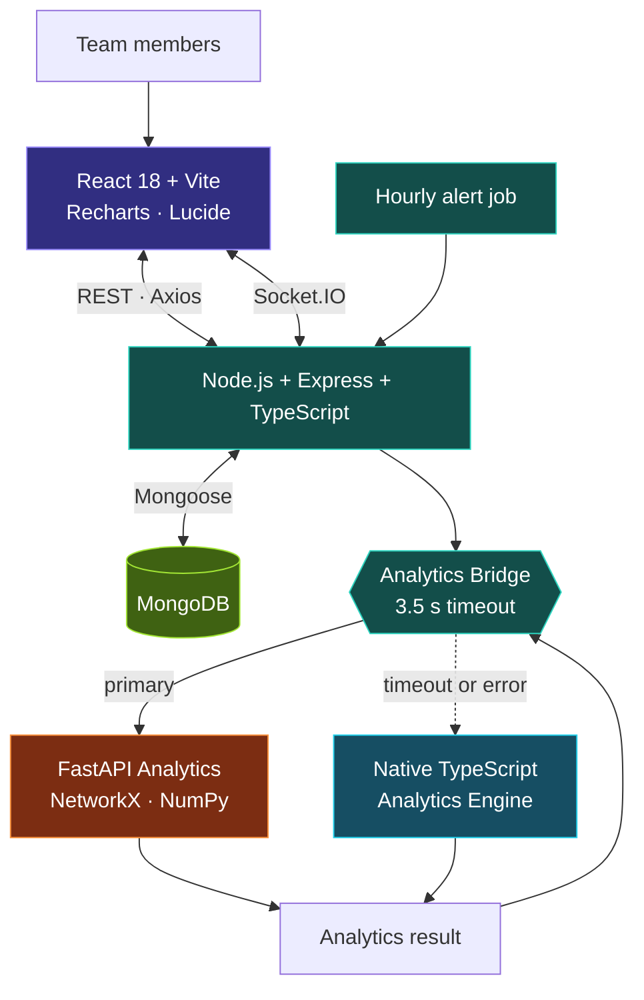
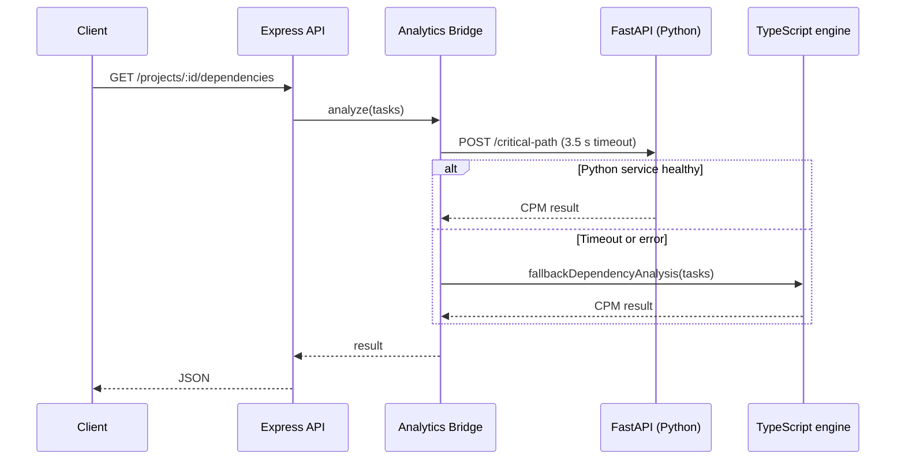
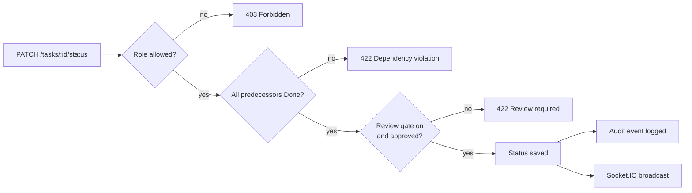

<div align="center">


**Make project progress visible. Predict schedule risk. Build accountable teams.**

A full-stack project management platform for student software teams that plans dependencies,
enforces delivery quality, balances workload, and measures contribution fairly,
with every number explainable and every action auditable.

<br/>


<br/><br/>

[**Features**](#-what-it-does) &nbsp;·&nbsp;
[**Intelligence**](#-the-intelligence-layer) &nbsp;·&nbsp;
[**Architecture**](#-architecture) &nbsp;·&nbsp;
[**Quick Start**](#-quick-start) &nbsp;·&nbsp;
[**Demo**](#-try-it-in-five-minutes) &nbsp;·&nbsp;
[**API**](#-api-at-a-glance) &nbsp;·&nbsp;
[**Docs**](#-documentation)

</div>

<br/>

## ✦ The Problem

Task boards tell you what is *assigned*. They don't tell you what is *blocking delivery*, which delay will actually move the deadline, who is quietly overloaded, or whether the person who closed the most tickets contributed the most.

**TeamPulse AI** puts those answers in one workspace: a dependency graph with critical-path scheduling, a what-if delay simulator, enforced quality gates, capacity-aware rebalancing, and a five-signal contribution model, all backed by an append-only activity ledger.

> Built as a software engineering master project for **TechTrix'26 · BONUS 02**.

<br/>

## ✦ At a Glance

| | | | |
|:---:|:---:|:---:|:---:|
| **50+**<br/><sub>REST routes</sub> | **14**<br/><sub>Mongoose models</sub> | **4**<br/><sub>project roles, enforced server-side</sub> | **3**<br/><sub>services: UI, API, analytics</sub> |
| **5**<br/><sub>contribution dimensions</sub> | **5**<br/><sub>health-score factors</sub> | **2**<br/><sub>analytics engines, with automatic failover</sub> | **0**<br/><sub>synthetic records on first boot</sub> |

<br/>

## ✦ What It Does

<table>
<tr>
<td width="50%" valign="top">

### 🗂 Project & Task Management
- Project workspaces with codes, deadlines and team rosters
- **Kanban**, **Table** and **Timeline** task views
- Milestones with auto-calculated progress and criteria checklists
- Blocker reporting with severity, and resolution tracking
- Comments and file attachments on tasks
- Reports with one-click **CSV export**

</td>
<td width="50%" valign="top">

### 🕸 Dependency Intelligence
- Finish-to-Start dependencies stored as a validated **DAG**
- **Cycle detection** before any edge is saved
- Topological execution ordering
- **Critical Path Method**: ES, EF, LS, LF and total slack
- Blocker root-cause view: directly blocked vs. downstream at-risk
- **What-if delay simulation** that never touches saved data

</td>
</tr>
<tr>
<td width="50%" valign="top">

### ⚖ Workload Intelligence
- Per-member weekly capacity (hours)
- Over-capacity (>100%) and under-utilised (<50%) detection
- Advisory redistribution that matches tasks to skills and capacity
- **Human-approved**: nothing is reassigned until a manager says so
- Composite **project health score** (0–100) with recommendations

</td>
<td width="50%" valign="top">

### 🎯 Fair Contribution Analytics
Individuals are scored on five transparent signals, not task counts:
- Task completion
- On-time delivery
- Peer-review stewardship
- Problem-solving and unblocking
- Estimation accuracy

</td>
</tr>
<tr>
<td width="50%" valign="top">

### 🛡 Quality & Accountability
- **Dependency gate**: no `Done` while predecessors are open
- **Peer-review gate**: optional approved review before `Done`
- **RBAC**: Owner, Manager, Member, Reviewer
- **Append-only audit ledger** enforced at the model layer
- Deduplicated notifications, one alert per event per day

</td>
<td width="50%" valign="top">

### ⚡ Real-Time Collaboration
- Socket.IO rooms per project and per user
- Live activity feed and notification delivery
- Hourly background checks for overdue tasks and stalled blockers
- Email-bound invitations with **7-day expiring tokens**
- JWT auth with refresh-token rotation and password reset

</td>
</tr>
</table>

<br/>

## ✦ The Intelligence Layer

### Critical Path Method

Tasks form a directed graph $G=(V,E)$ where each edge is a Finish-to-Start constraint. Completed tasks contribute zero remaining duration, so the critical path always describes *work still ahead*.

$$ES_i=\max_{p\in \mathrm{Pred}(i)}EF_p \qquad EF_i=ES_i+D_i$$

$$LF_i=\min_{s\in \mathrm{Succ}(i)}LS_s \qquad LS_i=LF_i-D_i$$

$$\mathrm{Slack}_i = LS_i-ES_i \qquad \text{Critical path}=\{\,i : \mathrm{Slack}_i=0 \,\}$$

Here $D_i$ is the task's remaining hours, falling back to its estimate. If the graph contains a cycle, the engine reports the offending nodes instead of producing a schedule.

### What-If Delay Propagation

Pick a task, enter a hypothetical delay in hours, and the engine re-runs CPM on a copy of the graph and diffs it against the baseline:

| Reported | Meaning |
|---|---|
| Project slippage | Change in total project duration |
| Critical-path shift | Tasks that enter or leave the critical path |
| Downstream impact | Per-task finish-time shifts and updated slack |

The simulation is deterministic and **read-only**; persisted schedules are never modified.

### Contribution Index

$$\text{Index}=0.35\,C+0.20\,T+0.15\,R+0.15\,E+0.15\,P$$

| Symbol | Signal | Weight |
|:---:|---|:---:|
| $C$ | Task completion: tasks and estimated hours delivered | 35% |
| $T$ | Timeliness: on-time vs. late completions | 20% |
| $R$ | Review stewardship: reviews conducted, approvals, comments | 15% |
| $E$ | Estimation accuracy: planned vs. logged effort | 15% |
| $P$ | Problem-solving: blockers reported early and resolved | 15% |

Each member also gets generated strengths and per-dimension scores, so the number is never a black box.

### Project Health Score

A weighted composite from 0 to 100: **≥ 80 Healthy**, **50–79 At Risk**, **< 50 Critical**.

| Factor | Weight |
|---|:---:|
| Milestone delivery | 25% |
| Critical and overdue tasks | 25% |
| Blocked tasks and dependencies | 20% |
| Critical-path delays | 15% |
| Workload capacity and pending reviews | 15% |

### Workload Rebalancing

$$\text{Utilisation}_m=\frac{\sum \text{remaining hours of open tasks}}{\text{weekly capacity}_m}\times 100$$

When a member exceeds the overload threshold (default 100%), the engine looks for unstarted tasks that can move to an under-loaded member (default below 50%) **without pushing the target over capacity**, preferring skill matches. The result is a recommendation with its reasoning attached, applied only on manager approval.

<br/>

## ✦ Architecture



### Dual-engine analytics

The backend never depends on the Python service being up. Every analytics call (dependencies and CPM, delay propagation, workload, contribution, health) goes through the **Analytics Bridge**, which tries FastAPI first and transparently falls back to a TypeScript implementation of the same algorithms.



A dedicated dual-engine suite (`stage4_analytics_parity`) exercises the TypeScript path for CPM, cycle detection and the other analytics.

### Quality gates on every status change



Because gates live in the API, they hold no matter which client calls it.

### Technology stack

| Layer | Technologies |
|---|---|
| **Frontend** | React 18, Vite 6, React Router 6, Recharts, Lucide React, Axios, Socket.IO client, custom CSS design system (dark theme) |
| **API** | Node.js, Express, TypeScript, Mongoose, Socket.IO, Multer, node-cron |
| **Auth** | JWT access tokens (15 min), rotating refresh tokens (30 d), bcryptjs |
| **Analytics** | Python, FastAPI, Uvicorn, Pydantic, NetworkX, NumPy |
| **Data** | MongoDB 6+ |
| **Testing** | `tsx`-driven integration suites, Pytest |

<br/>

## ✦ Repository Layout

```text
TeamPulse-AI/
├── frontend/                  React 18 + Vite client
│   └── src/
│       ├── components/        Sidebar, Topbar, TaskModal, TaskDetailModal, ErrorBoundary
│       ├── context/           AuthContext, ProjectContext
│       ├── pages/             Landing, Overview, Tasks, Dependencies, Workload,
│       │                      Milestones, Health Insights, Contributions, Reports, Auth
│       └── services/          Axios API client, Socket.IO manager
│
├── backend/                   Express + TypeScript API
│   ├── src/
│   │   ├── config/            Environment and database setup
│   │   ├── controllers/       Auth, projects, tasks, dependencies, workload,
│   │   │                      contributions, health, reviews, reports, ...
│   │   ├── middleware/        JWT auth, RBAC, uploads, error handling
│   │   ├── models/            14 Mongoose models
│   │   ├── routes/            Route definitions
│   │   └── services/          analyticsBridge, socketService, activityService, alertCronService
│   ├── scripts/               Demo seed, demo reset, workspace helpers
│   └── tests/                 5 integration suites
│
├── analytics/                 FastAPI analytics engine
│   ├── app/
│   │   ├── algorithms/        dag.py (cycles, topo sort) · cpm.py (CPM, delay propagation)
│   │   ├── models/            Pydantic request and response schemas
│   │   └── services/          workload · contribution · health
│   └── tests/                 Pytest suite
│
└── docs/                      Architecture, API, runbook, decisions, audit, progress
```

<br/>

## ✦ Quick Start

### Prerequisites

| Tool | Version |
|---|---|
| Node.js + npm | 20+ / 9+ |
| Python | 3.10+ |
| MongoDB | 6+ (local or Atlas URI) |
| Git | any recent |

### 1 · Clone

```bash
git clone https://github.com/AbnishAIML/TeamPulse-AI.git
cd TeamPulse-AI
```

### 2 · Configure

Each service ships a `.env.example`. Copy it and adjust:

```bash
cp backend/.env.example   backend/.env
cp frontend/.env.example  frontend/.env
cp analytics/.env.example analytics/.env
```

<details>
<summary><b>Environment variable reference</b></summary>

<br/>

**`backend/.env`**

| Variable | Default | Purpose |
|---|---|---|
| `PORT` | `5000` | API port |
| `MONGODB_URI` | `mongodb://127.0.0.1:27017/teampulse_db` | Database connection |
| `JWT_SECRET` | *(dev default)* | Signs access tokens. **Required when `NODE_ENV=production`** |
| `JWT_EXPIRES_IN` | `15m` | Access-token lifetime |
| `REFRESH_SECRET` | *(dev default)* | Signs refresh tokens. Set your own |
| `REFRESH_EXPIRES_IN` | `30d` | Refresh-token lifetime |
| `CLIENT_URL` | `http://localhost:5173` | Frontend origin |
| `ANALYTICS_SERVICE_URL` | `http://localhost:8000` | FastAPI engine |
| `ANALYTICS_TIMEOUT_MS` | `3500` | Wait before falling back to TypeScript |
| `UPLOAD_DIR` | `uploads` | Attachment storage directory |

**`frontend/.env`**: `VITE_API_URL=http://localhost:5000/api`, `VITE_SOCKET_URL=http://localhost:5000`

**`analytics/.env`**: `PORT=8000`, `ALLOWED_ORIGINS=http://localhost:5173,http://localhost:5000`

</details>

> **Use your own secrets.** The values in `.env.example` are development placeholders. Generate fresh ones for anything beyond your laptop and never commit a real `.env`.

### 3 · Run the four services

Open separate terminals from the repository root.

```bash
# MongoDB (Windows service shown; use your own start method elsewhere)
net start MongoDB
```

```bash
# Backend API → :5000
cd backend && npm install && npm run dev
```

```bash
# Analytics engine → :8000   (optional: the API falls back to TypeScript without it)
cd analytics
python -m venv .venv && source .venv/bin/activate      # Windows: .venv\Scripts\activate
pip install -r requirements.txt
python run.py
```

```bash
# Frontend → :5173
cd frontend && npm install && npm run dev
```

Open **http://localhost:5173** and register an account.

| Service | URL | Health check |
|---|---|---|
| Frontend | `http://localhost:5173` | — |
| Backend API | `http://localhost:5000/api` | `GET http://localhost:5000/health` |
| Analytics | `http://localhost:8000` | `GET http://localhost:8000/health` |
| MongoDB | `mongodb://127.0.0.1:27017/teampulse_db` | — |

<br/>

## ✦ Try It in Five Minutes

TeamPulse starts with an **empty database** by design. You can create your own data or load an optional demo project.

### Option A: Load the demo project

```bash
cd backend
npm run seed:demo      # creates 4 demo users and one demo project
```

| Role | Email | Password |
|---|---|---|
| Project Owner | `lead@demo.local` | `demo1234` |
| Project Manager | `sam@demo.local` | `demo1234` |
| Team Member | `taylor@demo.local` | `demo1234` |
| Reviewer | `morgan@demo.local` | `demo1234` |

The demo project has the review gate enabled, an active blocker, and an over-capacity member, so the interesting screens have something to show. To remove it:

```bash
npm run seed:reset     # deletes only @demo.local users and [DEMO DATA] projects
```

> `seed:reset` is scoped to demo-tagged records. It does not wipe the database.

### Option B: Build your own walkthrough

1. **Register**, then **create a project** and switch on the *peer-review gate*.
2. **Invite** a teammate as `Reviewer`. Copy the 7-day invite link.
3. **Create two tasks** (say, *Sensor Driver* 12 h and *Path Planner* 20 h) and make the second depend on the first.
4. Open **Dependencies**: inspect the topological order, critical path and slack.
5. Run **What-If Delay**: add 16 h to the first task and watch the project end date and critical path move.
6. Drag *Path Planner* to **Done**. It is **blocked (422)** because its predecessor isn't finished.
7. Move *Sensor Driver* to **In Review** and request a review. Closing it without approval is blocked too; approve as the reviewer and it completes.
8. Open **Workload** for utilisation and rebalancing advice, then **Reports** to export a CSV.

<br/>

## ✦ Product Tour

| Page | Route | What you get |
|---|---|---|
| **Overview** | `/dashboard` | Progress, health gauge and workload at a glance |
| **Task Board** | `/dashboard/tasks` | Kanban, table and timeline views with filters |
| **Milestones** | `/dashboard/milestones` | Delivery progress and criteria checklists |
| **Dependencies** | `/dashboard/dependencies` | DAG, critical path, blocker root-cause, delay simulator |
| **Workload** | `/dashboard/workload` | Capacity bars and advisory reassignment |
| **Health Insights** | `/dashboard/insights` | Scored risk factors and actionable recommendations |
| **Contributions & Audit** | `/dashboard/activity` | Five-signal analysis plus the immutable activity feed |
| **Reports** | `/dashboard/reports` | Delivery reports with CSV export |

<br/>

## ✦ Roles & Permissions

Four project roles, enforced by backend middleware (the UI only reflects them).

| Capability | Owner | Manager | Member | Reviewer |
|---|:---:|:---:|:---:|:---:|
| View workspace and analytics | ✅ | ✅ | ✅ | ✅ |
| Create tasks and milestones | ✅ | ✅ | ✅ | — |
| Edit task details | ✅ | ✅ | Assigned tasks only¹ | — |
| Delete tasks | ✅ | ✅ | — | — |
| Manage dependencies | ✅ | ✅ | ✅ | — |
| Report and resolve blockers | ✅ | ✅ | ✅ | — |
| Request peer review | ✅ | ✅ | ✅ | — |
| Submit review decision | ✅ | ✅ | — | ✅ |
| Apply workload redistribution | ✅ | ✅ | — | — |
| Manage members and roles | ✅² | — | — | — |
| Archive project | ✅ | — | — | — |

<sub>¹ Members may update status, hours and notes on tasks assigned to them. &nbsp; ² The last owner cannot be removed.</sub>

<br/>

## ✦ Real-Time & Background Jobs

**Socket.IO** clients join `project:<id>` and `user:<id>` rooms.

| Event | Room | Payload |
|---|---|---|
| `activity:new` | project | A new audit-ledger entry |
| `notification:new` | user | A new alert for that user |

**Hourly alert job** (`node-cron`) raises two kinds of notification:
- **Overdue tasks** → the assignee
- **Blockers unresolved for more than 24 h** → project owners and managers

Each alert carries a unique `dedupKey` scoped to the day, enforced by a sparse unique index, so repeat runs never spam the same person twice.

<br/>

## ✦ API at a Glance

Base URL `http://localhost:5000/api`. Every route except register, login, refresh and password reset needs a `Bearer` token. Full tables live in [`docs/API.md`](docs/API.md).

| Area | Representative routes |
|---|---|
| **Auth** | `POST /auth/register` · `/auth/login` · `/auth/refresh` · `/auth/logout` · `/auth/forgot-password` · `/auth/reset-password` · `GET /auth/me` |
| **Projects** | `GET/POST /projects` · `GET/PUT/DELETE /projects/:id` · member and invitation management |
| **Tasks** | `GET/POST /projects/:id/tasks` · `PATCH /tasks/:id/status` · blocker report and resolve |
| **Dependencies** | `GET /projects/:id/dependencies` · `POST /projects/:id/dependencies/simulate-delay` · `POST /tasks/:id/dependencies` |
| **Reviews** | `POST /tasks/:id/review/request` · `POST /tasks/:id/review/decision` |
| **Analytics** | `GET /projects/:id/workload` · `/contributions` · `/health` · `/activity` |
| **Reports** | `GET /projects/:id/reports/summary` · `/reports/export-csv` |
| **Notifications** | `GET /notifications` · `PATCH /notifications/:id/read` · `PATCH /notifications/read-all` |

**Failures are explicit.** Dependency and review violations return `422`; permission failures return `403`.

<br/>

## ✦ Testing

```bash
# Backend: 5 integration suites (needs a reachable MongoDB)
cd backend && npm test

# Analytics: Pytest
cd analytics && python -m pytest tests/

# Production builds
cd backend  && npm run build
cd frontend && npm run build
```

| Suite | Focus |
|---|---|
| `api` | Core models, bcrypt hashing, project and task basics |
| `stage3_rbac_transitions` | RBAC, refresh-token rotation and reuse prevention, gated status transitions |
| `stage4_analytics_parity` | Dual-engine analytics: CPM, cycle detection and fallback behaviour |
| `stage5_notifications_realtime` | Audit-ledger immutability, notification dedup, real-time delivery |
| `stage6_userflow_audit` | End-to-end user flow with the quality gates enabled |

The project's [progress log](docs/PROGRESS.md) records these suites passing at the time of the final build. Re-run them on your own checkout to confirm current status.

<br/>

## ✦ Security Model

**Built in**
- Short-lived access tokens, **hashed refresh tokens with rotation**, and revocation on reuse or password change
- bcrypt password hashing
- Server-side RBAC on every protected route, with last-owner protection
- Append-only `ActivityEvent` collection (Mongoose hooks reject update and delete operations)
- Blocklist for executable and script uploads
- `JWT_SECRET` is mandatory at boot when `NODE_ENV=production`

**Before a public deployment**, tighten these development-friendly defaults:
- [ ] Restrict CORS and Socket.IO origins (currently open to `*`) to your frontend origin
- [ ] Replace every placeholder secret, including `REFRESH_SECRET`
- [ ] Add rate limiting and security headers (e.g. `helmet`) in front of the API
- [ ] Lower and enforce the upload size cap and an allow-list of file types
- [ ] Run MongoDB as a replica set so audit writes can use transactions

<br/>

## ✦ Documentation

| Document | Contents |
|---|---|
| [`docs/RUNBOOK.md`](docs/RUNBOOK.md) | Ports, environment, startup order, troubleshooting |
| [`docs/ARCHITECTURE.md`](docs/ARCHITECTURE.md) · [`docs/ARCH.md`](docs/ARCH.md) | System design, algorithms and formulas |
| [`docs/API.md`](docs/API.md) | REST endpoint reference |
| [`docs/DECISIONS.md`](docs/DECISIONS.md) | Design decisions and their rationale |
| [`docs/AUDIT.md`](docs/AUDIT.md) | Audit findings and hardening notes |
| [`docs/PROGRESS.md`](docs/PROGRESS.md) | Build stages and verification evidence |
| [`docs/OPTIMIZATION_REPORT.md`](docs/OPTIMIZATION_REPORT.md) | Performance work and results |
| [`docs/KNOWN_ISSUES.md`](docs/KNOWN_ISSUES.md) | Environment notes |

<br/>

## ✦ Roadmap

- [ ] Richer health trends over time (snapshots are already modelled)
- [ ] Interactive critical-path graph visualisation
- [ ] Workload forecasting beyond the current week
- [ ] More export formats and report filters
- [ ] End-to-end browser tests and CI deployment pipeline

<br/>

## ✦ Contributing

1. Fork the repo and create a feature branch.
2. Keep the change focused and in line with the existing architecture.
3. Run the relevant tests and builds.
4. Open a pull request describing what changed and how you verified it.

Please keep credentials and exploit details out of public issues.

<br/>

## ✦ License

No license file is currently included, so all rights are reserved by default. Add a `LICENSE` (MIT, Apache-2.0, etc.) before inviting reuse.

<br/>

<div align="center">

**TeamPulse AI** · *Better planning. Transparent contribution. Smarter execution.*

Built for **TechTrix'26 · BONUS 02** by [**AbnishAIML**](https://github.com/AbnishAIML)


</div>